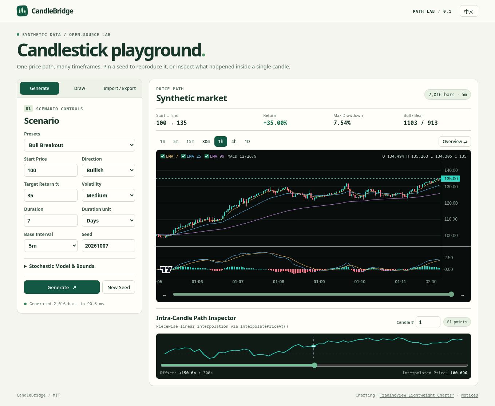

# CandleBridge

[Live playground](https://slwyts.github.io/candlebridge/) · [中文](README.zh-CN.md) · [Library API](packages/candlebridge/README.md) · [Model & reproducibility](docs/model.md)

Generate a seeded synthetic price path, then look at it as candlesticks. With the endpoint lock on, the last close is the price you specify; with it off, the path ends wherever the simulation takes it. A five-minute candle and its five one-minute candles describe the **same** underlying path.



## Run the playground

Use Node.js 24 LTS (24.11 or newer) and npm. From a fresh checkout:

```sh
npm ci
npm run dev
```

Open the URL printed by Vite. Change a scenario or its seed, generate it, and switch timeframes **without resampling the randomness**. Use Draw to edit the actual base candles; Data Exchange exports what is on the workspace, including edits. Full JSON retains intrabar points, OHLC-only JSON and CSV do not. The code snippet reproduces the last successful dataset, not unsaved control changes. The UI supports English and Chinese (`?lang=en` / `?lang=zh`).

No backend, credentials, price feed, CDN script or exchange account is required. The chart and its Worker are built into the static site. The paths are simulations, not observed trades. The library does not generate volume.

## Use the library

`packages/candlebridge` is a standalone zero-runtime-dependency package (ES modules, CommonJS, TypeScript declarations). To try it **before any registry publication**, run `npm run build:lib` in this checkout, then:

```js
import { generateCandles, resampleCandles } from 'candlebridge';

const bars = generateCandles({
  startTime: Date.UTC(2026, 0, 5), // milliseconds
  intervalSeconds: 300,
  count: 288, // 24 hours of five-minute candles
  startPrice: 100,
  endPrice: 108,
  minimumPrice: 80,
  maximumPrice: 125,
  seed: 17
});
console.log(bars[0].open, bars.at(-1).close); // 100, 108
const hourly = resampleCandles(bars, 3600); // 24 candles
```

To use it from another project, run `npm pack --workspace=candlebridge` here and install the resulting `.tgz` there. See the [package README](packages/candlebridge/README.md) for the worker entry, JSON schema and limits.

## Build, verify, host

```sh
npm run format:check
npm run typecheck
npm test
npm run build
npx playwright install chromium --only-shell
npm run test:browser
npm run test:package
npm run preview
```

- **Library:** `packages/candlebridge/dist/`. The package smoke test installs the packed archive offline in a clean directory, then compiles and runs ESM and CommonJS consumers.
- **Website:** serve the contents of `apps/playground/dist/` over HTTP(S), at a root **or repository subpath**. `file://` is not a supported worker origin. `npm run preview` serves the build locally. For library changes during UI development, rerun `npm run build:lib`; the site imports the actual built package.
- **CI:** [checks](.github/workflows/checks.yml) run on pushes and pull requests. To publish the site to GitHub Pages, set **Settings → Pages → Source → GitHub Actions**, then run [Deploy playground](.github/workflows/pages.yml) manually on the intended branch. The workflow deploys only the static site; none of these commands publishes a package to npm.

The CandleBridge source is [MIT licensed](LICENSE). The playground displays TradingView attribution and ships separate notices for its chart and other UI dependencies.
