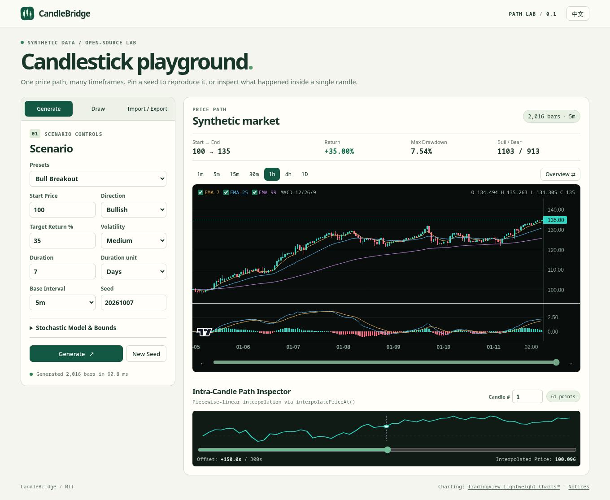

# CandleBridge

[English](README.md) · [库 API 与格式](packages/candlebridge/README.md) · [模型与复现规则](docs/model.md)

CandleBridge 是一个**合成 K 线算法库和交互实验台**。先生成一条 1 秒或 5 秒精度的价格路径，再用同一条路径计算不同周期的开、高、低、收。你可以指定终点，也可以让价格随机走到最后。数据适合测试图表、教学和回放；不是实际行情，不含成交量或订单。



## 本地运行

推荐 Node.js 24 LTS（至少 24.11）。在仓库根目录：

```sh
npm ci
npm run dev
```

打开终端显示的地址，右上角可切到中文，也可给地址加 `?lang=zh`。

1. **自动生成**：选预设，或设置起始价、目标涨跌幅、时长、基础周期和种子。高级设置中可调整肥尾、波动记忆、跳跃、状态切换、起始 UTC 时间与边界。默认边界可以随目标扩展，手动锁定的边界不会被改写。生成失败会提示原因，保留上一次成功的数据。
2. **检查路径**：图表可切周期、缩放，显示 EMA 7/25/99 和 MACD 12/26/9。长序列按每页 6,000 根查看，指标从本页首根开始计算，原始数据仍可完整导出。下方检查器选择的是**基础周期**的某一根，可拖动定位到盘中毫秒对应的插值价格。
3. **手绘与交换**：在基础 K 线上拖动修改收盘走势，后一根开盘随之衔接。完整 JSON 保留编辑结果和盘中点；精简 JSON / CSV 仅保留 OHLC。旧式 `klines`、`openPrice` 和 `[开,高,低,收]` 格式都可读取，也可导出兼容 JSON。纯参数生成可复制代码复现，手绘或导入后请用完整 JSON。

## 独立使用算法

算法包位于 `packages/candlebridge/`，无第三方运行依赖。安装仓库依赖后，执行 `npm run build:lib`，即可在本仓库中 `import { generateCandles } from 'candlebridge'`。外部项目在正式发布前可用 `npm pack --workspace=candlebridge` 打出压缩包，然后安装本地 `.tgz`；不需要连接任何平台服务。

## 验证与部署

`npm run format:check`、`npm run typecheck` 和 `npm test` 检查代码、类型和算法；`npm run build` 同时构建算法包与网站。安装 Chromium（`npx playwright install chromium --only-shell`）后，`npm run test:browser` 用实际生产构建测试浏览器交互。`npm run test:package` 在临时目录离线安装 npm 包，分别验证两种模块格式和类型声明。

只部署 `apps/playground/dist/` 到静态主机即可；浏览器 Worker 需要 HTTP(S)，不能双击 HTML 文件。`npm run preview` 可本地预览。GitHub Pages 发布入口为 [.github/workflows/pages.yml](.github/workflows/pages.yml)：仓库 Settings → Pages 选择 GitHub Actions，随后手动运行 **Deploy playground**。不会自动发布 npm 包。

项目采用 [MIT 协议](LICENSE)；图表基于 TradingView Lightweight Charts，第三方声明随网站分发。
